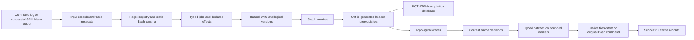

# rusty_make

A conservative Rust proof of concept for executing GNU Make command logs with
native filesystem operations, dependency-safe batches, a copy-chain rewrite, and
a persistent content cache. GNU Make expands Makefiles; this tool does not parse
Makefiles or implement a shell. Linux with Bash is the supported execution host.
Windows-looking paths are tested as Bash arguments, **not** as Windows shell syntax.
No Windows performance or compatibility claim is made.

## Build and run

```sh
cargo build
cargo test
cargo run -- --commands commands.txt -j8 --explain
cargo run -- --commands commands.txt --dry-run --dump-plan plan.json --dump-graph graph.dot
cargo run -- --commands commands.txt --compile-commands compile_commands.json
cargo run -- --commands commands.txt --rebuild-all --no-optimize
```

Commands run relative to the **current working directory**, not the log's parent.
Do not replay untrusted logs: external commands have your process permissions.
The whole input is validated and classified before any job executes. A malformed
line, an ambiguous match, or a rejected registered command aborts the entire plan.
Unknown commands print exactly `unknown: <original line>` on stdout and remain
external jobs. Diagnostics, progress and explain output use stderr. Dry-run prints
human-readable waves to stdout; JSON is written only to the requested file.

| Option | Behavior |
| --- | --- |
| `--commands FILE` | Read a UTF-8 command log; otherwise invoke GNU Make |
| `-j N`, `--jobs N` | Maximum worker threads (default 1); must be positive |
| `--rebuild-all` | Ignore incremental hits; independent of optimization |
| `--no-optimize` | Disable graph rewrites, not native execution or batching |
| `--dump-graph FILE` | Graphviz DOT: original identity, type, strategy, dependency reasons |
| `--dump-plan FILE` | JSON: jobs, parsed metadata, edges, waves, versions, rewrite provenance |
| `--compile-commands FILE` | Compilation database using argv arrays, including in dry-run |
| `--python-script ID=PATH` | Repeatable exact script-specific registration |
| `--compiler-regex REGEX` | Repeatable replacement compiler matchers; executable spelling and argv stay unchanged |
| `--generated-header-source REGEX` | Repeatable opt-in source predicate for generated-header prerequisites |
| `--explain`, `--verbose` | Classifications, barriers, edges, rewrites, cache reasons, batches, results |
| `--dry-run` | Validate/export/display without executing jobs or writing the cache |
| `--make-arg ARG` | Forward one permitted planner argument (`--make-arg=-f`) |

### Synthetic working build

From the repository root after building:

```sh
cd fixtures/demo
../../target/debug/rusty_make --commands commands.txt -j4 --explain \
  --python-script generate=tools/generate.py \
  --python-script transform=tools/transform.py \
  --compile-commands compile_commands.json
./build/app
# 12
```

Requires `gcc`, `python3`, `sed` and Bash. This exercises all five native utility
families, two Python identities, a text transformation, compilation, linking, an
unknown external command, independent copies and a copy chain. Integration tests
copy this fixture into isolated temporary directories and compare **every regular
file's BLAKE3 hash** against sequential Bash execution and unoptimized execution.

### Python tool with declared generated output

The focused [Python/header example](examples/python_generated_headers.rs) is
runnable from the repository root:

```sh
cargo run --example python_generated_headers
```

It registers [`GenerateHeadersPy`](src/commands/generate_headers_py.rs), whose
clap parser and `Job` implementation own the contract for
[`tools/generate_header.py`](fixtures/python_headers/tools/generate_header.py).
The job declares script/template inputs and the generated-header output, then runs a real
Python generator plus C compiler in an isolated temporary directory. The fixture
deliberately lists the compiler **before** its generator. The header policy adds
the prerequisite, so Python runs first; the application prints
`generated answer: 42`.

This is an example of a trusted script-specific effect contract, not inference
of arbitrary Python behavior. `--python-script ID=PATH` alone only classifies the
script and remains opaque; precise effects require a trusted typed job registered
with `registry.register::<GenerateHeadersPy>()?`. Do not register both matchers for the same
command: ambiguity remains fatal.


### GNU Make planning

```sh
rusty_make MY_PARAM=x -j8
rusty_make --make-arg=-f --make-arg=Build.mk all -j8
```

Positional Make arguments and repeated `--make-arg` values retain their original
relative ordering, so later variable assignments take precedence as in GNU Make.

The wrapper runs `make -nB --trace -j1`, streams ordered stdout while retaining it,
and returns a parsed log only after Make exits successfully. Rust's `-j8` does not
reach Make. A conservative option allowlist rejects directory changes, overriding
parallelism, execution modes, arbitrary evaluation and Make control-variable
injection. Make environment controls are cleared; diagnostics use `LC_ALL=C`.
Original target identities from GNU Make traces are attached to jobs. Recognized
Make diagnostics are retained separately, never classified as unknown utilities.
Directory-scoped recursive logs are explicitly rejected rather than run in the
wrong directory. Stderr is inherited; ordering between stdout and stderr is not
claimed.

**Make dry-run is not side-effect-free, even with `--dry-run` on rusty_make.**
`$(file ...)`, `$(shell ...)`, Makefile regeneration, `+` recipes and recursive Make
can execute while generating the plan, including before a failed plan. Generated
files from successful planning are available to jobs. Forced recipes might be
replayed twice; Makefiles requiring that workflow are not safely supported. The
wrapper warns before launch. Use trusted Makefiles, preferably in an isolated
build tree. See [the detailed planning contract](docs/coreutils.md#gnu-make-wrapper-contract).

## Architecture



* `input.rs`: physical source line and original command spelling; Make target
  context; active Bash backslash-newline continuations. Open quotes, heredocs and
  compound constructs spanning independent physical records are rejected. One-line
  compound commands may remain external. CRLF records work; CRLF continuations do
  not masquerade as Bash continuations.
* `shell.rs`: **tree-sitter-bash** identifies shell structure and validates the
  whole tree; **shell-words** decodes only proven static words. This was chosen
  over a shell interpreter because the PoC needs syntax boundaries and can defer
  expansion to Bash. Tree-sitter is error-recovering, not an authoritative Bash
  validator, so opaque constructs also receive `bash -n` syntax-only validation.
  No shell expansion runs during parsing. Static commands incur no syntax-check
  subprocess. Parser reference: [tree-sitter-bash Rust API](https://docs.rs/tree-sitter-bash/0.25.1/tree_sitter_bash/).
* `registry.rs`: deterministic registered regex order. **Every matching regex
  counts**, including overlaps within one handler; there are no priorities or
  specificity rules. Exactly one match dispatches the typed parser; rejection is
  fatal. Valid complex syntax remains original-text external work with a barrier.
* `job.rs`: the public typed `Job` trait owns parsing, declared effects, validation,
  execution and batch behavior. `JobRecord` combines a serializable `JobSpec` with
  private erased runtime behavior; there is no central operation enum.
* `commands/`: each command has its own module, including `cp.rs`,
  `generate_headers_py.rs`, `compiler.rs`, `nm.rs`, `ar.rs` and the other binary
  tools. `commands/mod.rs` only composes registrations. Shared filesystem and
  binary-effect helpers contain no kind-to-executor dispatcher.
  Understood external tools become ordinary DAG nodes; uncertain modes retain a
  diagnosed passthrough barrier. File redirection alone does not force a barrier.
* `graph.rs`: original-order RAW, WAW and WAR edges; ancestor/descendant path
  conflicts conservatively order directory operations. `mkdir -p` includes
  implicit parent effects, including prerequisites for sibling outputs.
  Unknown-effect jobs normally act as global barriers; explicit generated-header
  prerequisites can authorize a known producer before its selected compiler.
  Unrelated unknown ordering is retained. Independent operations share waves. Existing
  symlinks are resolved for hazard comparison; existing hardlink aliases force
  barriers. POSIX backslashes are never normalized into separators. Logical
  `path@version` reads and writes aid inspection; files are not snapshotted, so
  WAR edges protect readers from later overwrites. Kahn sorting reports cycles.
* `scheduler.rs`: deterministic waves, then concrete-type/kind/strategy groups.
  Each group invokes its typed batch override once through an erased adapter.
  The default batch loop executes members sequentially; handlers can override it.
  Different groups can run concurrently up to `--jobs`. Native groups avoid subprocesses.
  Compiler and opaque jobs retain conservative ordering except for explicit selected
  generated-header prerequisites. First failure cancels not-yet-started work;
  already-running independent
  work finishes, no dependent wave starts, and the process exits nonzero.
* `rewrite.rs`: extensible `GraphRewrite` trait plus a real adjacent copy-chain
  rewrite. `cp A B; cp B C` becomes one two-output operation. **B is preserved**,
  even if it is a final artifact or has other consumers. For ordinary distinct
  new output files it reads A once and writes both outputs with a bounded 64 KiB
  buffer. Existing/aliased/unsupported paths fall back to the original two-copy
  sequence. Source overwrite patterns are rejected; all original jobs remain in
  `provenance`. The opt-in unity example demonstrates a separate compiler graph
  transform; it is not enabled by normal CLI optimization.

The graph uses pairwise hazard comparisons (quadratic in command count), not a
fully sequential chain. This favors a small, auditable implementation over a
premature indexed dependency engine. No throughput/speedup benchmark is claimed.

### Runtime behavior and persistent plans

`Job` is deliberately a typed trait, not an object-safe interface. Registration
creates a private erased adapter that downcasts a compatible group and calls
`T::execute_batch`. This supports real typed overrides without editing the
scheduler or trying to call a static method through `dyn Job`.

`JobRecord.source` and `shell` retain original text, line, target and shell syntax.
`spec.parsed` is the serialized typed payload. Graph policies may add conservative
inputs/outputs and `spec.effect_reason` without changing that payload. Replacing a
typed command uses `record.replace(new_job)?`; transforms must explicitly retain
any policy-added effects and original provenance.

Serialize a graph with `serde_json::to_vec(&graph)?`. Restore it with
`BuildGraph::from_json(&bytes, &registry)?`, after registering every implementation
used by executable nodes **and provenance**. Stable `Job::TYPE` tags identify
decoders; `Job::VERSION` rejects incompatible payload versions. Missing decoders,
incompatible versions and invalid graph constraints fail before a runnable graph
is returned. There is no generic `Deserialize` implementation or no-op fallback.

### Opt-in unity transform

```sh
cargo run --example unity_build
```

[`examples/support/unity_transform.rs`](examples/support/unity_transform.rs)
groups `.c` basenames by their stem component before `_`: `calc_add.c` and
`calc_mul.c` merge, while singleton `main.c` stays separate. Groups require one
compile-only C source and one explicit `.o` output per command, static shell
words, complete metadata, and exactly equal compiler executable and argument
order after removing only the source and separate `-o OUTPUT`.

A registered internal `UnitySource` job generates one translation unit; one
compiler produces one unity object. Every modeled pure-object link consumer
replaces all group objects with that object exactly once. Original object files
are **not** fabricated. Original compilation commands remain in provenance and
compilation-database exports. Planning and rejection do not write generated files;
the graph is replaced only after validation succeeds.

The runnable example compares isolated standalone/unity builds and checks the
application output, compiler invocation count and absence of old object outputs.
Its scope is intentionally conservative: opaque commands, unknown compiler flags,
response files, redirects, partial/unmodeled object consumers, generated source
inputs and required dependencies touching grouped commands reject the transform.
It also refuses to move grouped compilation across file-producing non-compiler
commands that could change implicit headers. Unrelated required dependencies survive.

Identical flags do **not** prove unity compatibility: static identifiers, macros,
pragmas, include ordering and `__FILE__` can change C behavior. Source selection
and compatibility remain the caller's responsibility. This example is opt-in,
not a default optimization or a claim of arbitrary C source equivalence.


## Supported command subsets

| Type | Implemented behavior | Conservative boundary |
| --- | --- | --- |
| `cp SRC DST` | In-process regular-file copy; existing destination permissions retained; new mode respects umask | Exactly two operands; directories, symlink operands, special bits and multiply-linked destinations rejected; no flags |
| `mkdir [-p\|--parents] PATH...` | Native creation; intermediate owner write/search for `-p` | Mode options rejected; overlapping directory effects ordered |
| `touch PATH...` | Native creation or atime/mtime update | Ordinary files only; no options; never skipped |
| `rm [-f\|--force] PATH...` | Native unlink; force ignores missing paths | No recursion/options beyond force; global barrier; never skipped |
| `mv SRC DST` | Native regular-file rename | Same filesystem; no options, directory/symlink/multiply-linked destination behavior; barrier; never skipped |
| `sed` | Typed `-e`, `-f`, `-n`, `-i[SUFFIX]`, operands; original command executed | No native sed/semantic inference; arbitrary scripts are global barriers and never cached |
| GCC/Clang/`cc`/C++ drivers | Typed include/library paths and common flags; partial source/output metadata | Unknown flags/response files preserved; conservative effects and no cache hits; explicit generated-header policy can order known prerequisites |
| Binary inspection and manipulation tools | Separate identities, original argv/redirections, typed file-effect subsets; GNU/LLVM/cross-prefixed names recognized | Known forms use ordinary file hazards, not global barriers; uncertain forms remain passthrough barriers; no native implementation or cache hits |
| Configured Python scripts | Independent identities across `python`, `python3[.N]`, `py`, absolute POSIX interpreter paths | No guessed script dependencies or interpreter options; original-text execution/barrier |
| Other programs | Visible `unknown:` external jobs | Unknown filesystem effects ordered against all other jobs |

Compiler include and library search paths support both separated and joined
forms: `-I include`, `-Iinclude`, `-L lib`, `-Llib`, including quoted paths with
spaces. `-isystem`, `-iquote` and `-idirafter` paths are also extracted (separate or
joined) into include-directory membership metadata. Search order remains in
original argv. Unknown options such as `-Wall`, `-std=c11`, `-lfoo` and extended
`-g`/`-O` forms do **not** abort planning. The original command executes unchanged,
and compilation database entries preserve every argument. Only the compiler
decides whether forwarded flags are valid; a compiler failure stops dependent work.

JSON metadata exposes `includes`, `library_paths`, `unparsed_args` and
`metadata_complete`. Unknown option arity is not guessed: following bare operands
stay opaque until another option boundary, so option values like
`-include generated.c` are not mistaken for compilation sources. Response-file
contents are likewise opaque. Sources hidden in those opaque operands are omitted
from compilation database entries rather than invented. Default output filenames
are not inferred when unknown arguments could change the compiler's mode;
explicit `-o` metadata is retained. Missing values for recognized flags remain
parsing errors. `--explain` reports partial metadata and preserved arguments.

### Arbitrary compiler executable names

Compiler parsing does not require a GCC/Clang basename. Default matchers recognize
common names for convenience; configure the compiler **role** explicitly for
other names, including quoted paths with spaces:

```sh
rusty_make --commands commands.txt \
  --compiler-regex "^'./tool chain/odd-driver'(?:\\s|$)" \
  --compile-commands compile_commands.json
```

Each repeatable `--compiler-regex` matches original command text and replaces only
the compiler matchers. Other roles remain registered; overlaps with them, or
between two custom compiler patterns, are fatal. Invalid patterns fail before
Make planning or execution. The executable spelling in `argv[0]` is neither
rewritten nor interpreted as a required compiler name. An unconfigured tool is
not guessed to be a compiler merely because it accepts `-o`.

Library callers can use `registry.replace_patterns::<Compiler>(&patterns)?` or
`registry.register_with::<Compiler, _>(classification, &patterns, Compiler::parse)?`.
`Compiler::from_argv(argv)?` is also name-agnostic for graph transforms.

Binary tools are registered for `nm`, `objdump`, `readelf`, `size`, `strings`,
`addr2line`, `c++filt`, `objcopy`, `strip`, `ar`, `ranlib`, `as`, `ld`, `elfedit`
and `dwp`. LLVM equivalents and `llvm-readobj`, `llvm-dwarfdump` and
`llvm-symbolizer` are recognized, including `llvm-cxxfilt`. Matching also covers
target prefixes (`arm-none-eabi-nm`), absolute/quoted POSIX executable paths,
numeric version suffixes (`llvm-objdump-18`), lowercase `.exe` spellings, and
`ld.bfd`, `ld.gold`, `ld.lld`, `gold` and `lld`. Recognition of `.exe` names is not
Windows shell support. LLVM names are classification-tested; runtime verification
uses the installed GNU tools.

All options are passed through unchanged, including options unknown to rusty_make.
The executable must be installed; its exit status determines success. External
execution is **not** an ordering barrier by itself. Understood invocations retain
their explicit inputs/outputs and may share waves with unrelated work.

Common precise forms include:

* `nm` file operands (default `a.out`), `objdump` header/section/symbol modes,
  `readelf` inspection, `size`, `strings` files or redirected stdin, `c++filt`
  positional symbols or redirected stdin, and supported `llvm-readobj` switches.
* `objcopy` explicit/in-place outputs, including add/update-section file inputs
  and multiple dump-section outputs; `strip` explicit/in-place output; normal
  `ar r[c/s/D]` archive updates; in-place `ranlib`/`elfedit`; explicit `dwp` inputs
  and `-o` output.

Only real RAW/WAR/WAW/directory hazards order these jobs. Two inspectors may read
the same object concurrently; an in-place mutation waits for earlier readers.
Appending to a shared report remains a read/write dependency. `--explain` and
JSON `effect_reason` distinguish precise effects from fallback reasons.

Unknown flags and response files still execute unchanged, but their effect set
is not guessed. Plugins, source/line modes, inherited stdin, assembly includes,
linker scripts/libraries and debug discovery remain barriers. In particular,
ordinary `objdump -d`/`-D` may follow separate debug files; an explicit
`--dwarf=no-follow-links` permits precise disassembly. `addr2line`, symbolizer and
dwarfdump modes with hidden debug inputs remain conservative. No flag is inserted
into the original command to change its semantics.

The precise subset assumes ordinary non-aliased regular files and stable tool
configuration. Existing symlink/hardlink operands and thin archives fall back to
barriers. If an earlier job creates one of these unsupported states after
planning, a runtime guard refuses the precise invocation before opening its
outputs and requests replanning; a new plan can then use a barrier. This avoids
silently executing against stale path or archive-member dependencies.

```sh
nm -n build/app > build/app.nm
objdump -d --dwarf=no-follow-links build/app > "build/app disassembly.txt"
readelf -a build/app >> build/inspection.txt
objdump -d build/app > build/app.dump 2> build/objdump.err
c++filt < mangled.txt > demangled.txt
```

Every tool supports applicable Bash file redirections, including stdout/stderr
overwrite and append, quoted filenames, stdin, and descriptor combinations such
as `> report.txt 2>&1`. Parent directories must already exist. Simple redirection
paths appear as known inputs/outputs in the JSON graph; append outputs are also
read/write artifacts. Multiple or ordering-sensitive redirects remain opaque but
are honored by executing the exact original command, never by rebuilding argv.

Simple stdin/stdout/stderr redirects and stdout append are recognized separately
from argv. Multiple/descriptor redirects and dynamic words, globbing, assignments,
pipelines, substitutions, loops and shell lists stay opaque. A simple redirection
adds file effects to a precise external job without discarding its tool inputs.
Native redirection-bearing utilities still use a conservative shell fallback;
no native handler drops shell file-opening effects. External execution uses
`bash --noprofile --norc -c` with `BASH_ENV` and `ENV` removed. Opaque programs
retain their original text and a barrier rather than misleading partial argv.

Native support is deliberately not a replacement for GNU's complete semantics:
ACLs, extended attributes, ownership preservation, sparse-file heuristics, unusual
filesystem races and timestamp-sensitive workflows are outside the supported
native subset. Native copy/mkdir/touch also reject symlink path components at
execution time: an earlier opaque job must not introduce aliases that invalidate
the planned hazards. Do not run another filesystem-mutating build concurrently
in the same root. A `.rusty_make/build.lock` excludes simultaneous rusty_make
executors; after a crash, verify no build is running before deleting a stale lock.
No transactional rollback is promised for a failed batch.

## Conditional generated-header dependencies

```sh
rusty_make --commands commands.txt \
  --generated-header-source '^src/special\.c$' --explain
```

The option is repeatable (patterns are ORed), disabled by default, and independent
of `--no-optimize`/`--rebuild-all`. It matches original compiler source-path
spellings, including source-bearing compile-and-link jobs.

The library accepts an arbitrary predicate with access to the job:

```rust
use std::path::Path;
rusty_make::headers::add_generated_header_dependencies(
    &mut graph,
    |_, source| source == Path::new("src/special.c"),
)?;
```

For every selected job, the policy scans **all declared plan outputs** for headers
beneath any of its `-I`, `-isystem`, `-iquote` or `-idirafter` directories. Paths are
normalized against the graph cwd and compared by components, so `include-extra`
does not match `include`. It adds each matching header as an input and **every
writer** as a producer prerequisite. Nonmatching compiler jobs are unchanged.

Header recognition uses case-insensitive suffixes `h`, `hh`, `hpp`, `hxx`, `h++`,
`inc`, `inl`, `ipp`, `tpp`, `tcc`, `cuh`. Self-output paths are excluded. This is
deliberately an overapproximation of generated headers, not preprocessing or
complete compiler dependency discovery. Implicit environment/sysroot searches,
opaque shell expansions and headers hidden in unknown option operands are not
resolved. Compiler jobs remain non-cacheable.

There is no filesystem crawl or guessed Python output. A generated file must
appear in `JobSpec.outputs`; the Python example shows that contract. Files created
internally during Make planning already exist before execution but have no replay
producer unless represented in the plan.

Requirements bind final generated-file versions and use original source-line
identities, retained through copy-chain fusion. A later **known-effect** producer
can move before the selected compiler. Real conflicting data hazards, unknown
future producers and unrelated unknown barriers are not silently overridden:
incompatible requirements report a cycle before any job runs. Policy failure
rolls back the graph. `--explain`, DOT and JSON show the new prerequisites;
JSON retains them in `required_dependencies`.

## Incremental builds

`.rusty_make/cache.json` stores schema/version, stable source position/target,
command/typed-payload fingerprints, cwd/environment fingerprints, and explicit
input/output BLAKE3 hashes plus permission bits. Files are rehashed every time:
there is no size/mtime shortcut. Directories use an existence/mode marker, not a
recursive hash (creating another child does not invalidate `mkdir -p`). Symlinks,
special files and hardlink aliases do not produce safe cache hits.

Built-in native copies/copy chains and mkdir jobs are cacheable; custom jobs may
opt in only when their declared effects completely describe their dependencies.
Touch is observable timestamp work and is always executed. Compiler headers,
Python scripts, sed programs and unknown commands may hide arbitrary dependencies:
these jobs and jobs with unknown-effect ancestors are not skipped. GCC `-MMD -MF`
depfiles were considered but are **not implemented**; it would be unsafe to cache
compiler jobs based only on command-line sources.
Known-effect external tools also remain non-cacheable until executable/tool
configuration fingerprints are implemented; that restriction does not serialize
them. When such a tool reruns and emits identical bytes, a cacheable downstream
native copy can still skip.

Cache evaluation happens in dependency order against current file contents. If an
upstream job runs because its arguments changed but writes identical bytes/modes,
a precisely modeled downstream job can still hit its cache. Missing/tampered
outputs and modified inputs force rebuilds. `--rebuild-all` bypasses every hit.
Records are invalidated and saved before launch, then recorded only for successful
completed jobs. Failed/incomplete jobs cannot retain an old success entry. Cache
writes use a synchronized temporary file and rename; interrupted writes may leave
`.rusty_make/cache.json.tmp`, which is explicitly reported instead of overwritten.
The cache is trusted build state, not an adversarial integrity boundary.

## Graph-aware compilation database transforms

The CLI emits standard `compile_commands.json` entries with `directory`, `file`,
`arguments` and optional `output`. Original argv is used rather than a quoted
shell string. One entry is emitted per recognized source; pure linking is omitted.
Compile-and-link invocations with sources are included. Opaque compiler shell
commands are not flattened into misleading entries.

The library exposes the holding object and the graph **before saving**:

```rust,no_run
use rusty_make::compdb::CompilationDatabase;
# fn export(graph: &rusty_make::graph::BuildGraph) -> anyhow::Result<()> {
let mut database = CompilationDatabase::from_graph(graph)?;
database.save_with_transform(graph, std::path::Path::new("compile_commands.json"),
    |graph, database| {
        // Inspect graph.jobs, graph.edges, versions and original provenance.
        for entry in &mut database.commands {
            if graph.jobs.iter().any(|job| job.source.target.as_deref() == Some("generated")) {
                entry.arguments.push("-DGENERATED_BUILD".into());
            }
            entry.directory = "/relocated/build".into();
        }
        Ok(())
    })?;
# Ok(()) }
```

Transforms may filter/add entries or modify fields. A transform error aborts before
touching the destination. The hook is a Rust library API, not evaluation of
arbitrary code from CLI configuration.

## Extending handlers

1. Create a serializable `Debug + Send + Sync + 'static` command type implementing
   `Job` in its own module. Keep its matcher, clap arguments, `parse`, `inputs`,
   `outputs`, `validate`, `execute` and optional `execute_batch` together.
2. Choose a unique stable `TYPE` and bump `VERSION` for incompatible persistence
   changes. Declare every effect; return `unknown_effects() == true` whenever
   effects are uncertain. Cacheability defaults to false.
3. Register it with `registry.register::<MyJob>()?`. For configured parser
   factories use `register_with::<MyJob, _>(classification, patterns, parser)?`;
   for internal transform-only types use `register_type::<MyJob>()?`.
4. Implement execution directly or use `commands::external::{execute_argv,
   execute_original}` when external behavior is intended. No enum or scheduler
   change is needed. See [`Cp`](src/commands/cp.rs) and
   [`GenerateHeadersPy`](src/commands/generate_headers_py.rs) for complete examples.
5. Test semantics, unsupported inputs, hazards, persisted restoration and actual
   execution. The isolated custom jobs in `tests/job_traits.rs` exercise the public
   extension and failure contracts.

The default `execute_batch` calls `context.run_each(items, ...)`, which validates
each member, handles native shell-redirection fallback, checks cancellation and
reports outcomes individually. Overrides must preserve those obligations and
report each completed node ID exactly once. Omitted results are accepted only
after failure/cancellation; duplicate/unknown IDs or unexplained omissions fail.
Only successful completed jobs gain cache records; no dependent wave runs after
failure. Different concrete types never share a batch merely because `kind()`
returns the same label.

For another opaque binary tool, use
`Registry::register_external("tool-name", &[r"^tool-name(?:\s|$)"])`. This preserves
all arguments and shell semantics without writing a flag parser; unknown effects
still force a barrier. Its patterns obey the same fatal ambiguity rules.


[Coreutils investigation](docs/coreutils.md) records reusable uutils crates, their
in-process APIs, process-global concerns, Windows status, GNU compatibility, MIT
license, dependencies and batching practicality. Individual lower-level APIs can
be reused, but CLI entry points are not assumed reentrant. The PoC chose narrow
standard-library operations rather than inherit CLI/global-state machinery.

## Validation and next improvements

Tests cover registry ambiguity (including within one handler and Python overlaps),
quoting/operators/paths, Make traces and continuations, RAW/WAR/WAW/directory
hazards, versions, cycles, barriers, typed batches, failure cancellation, copy-chain
differential execution, cache invalidation/content propagation, compilation
database transforms and real Make planning. Optional compiler/Make integration
tests skip with a message if their external tool is absent. No original Windows
project is required. Run `cargo build` and `cargo test` on the Linux host.

Verified on Linux with Rust 1.94.0, GNU Make 4.3 and GCC 13.3:

* `cargo build`: successful.
* `cargo test`: **186 passed**, no failures, including real compiler, Python, sed,
  Make and differential fixture execution.
* Standalone CLI fixture: 15 commands became 14 nodes with one copy-chain rewrite;
  generated application printed `12`. DOT, plan JSON and a two-entry compilation
  database were written and inspected.
* Native cache CLI smoke: `mkdir -p` plus two copies became two nodes; the cold
  run executed both, the identical second run executed **zero**, and
  `--rebuild-all --no-optimize` executed all three original commands. Final bytes
  matched the input. The real Make CLI smoke also preserved expansion-generated
  files and copied the planned output correctly.
* Compiler passthrough CLI smoke: joined/separated `-I` and `-L`, paths with
  spaces, and unknown-to-Rust flags (`-Wall`, `-Wextra`, `-std=c11`, `-lvalue`)
  compiled and linked against a generated static library; the application printed
  `12`. Exported plan metadata and original compilation argv were inspected.
* Binary-tool CLI smoke: 17 commands compiled, inspected, archived, copied,
  stripped, assembled and partially linked an object. Redirected reports included
  appended `nm` symbols and stdin-driven `c++filt` output (`foo()`); `as`/`ld`
  outputs retained the expected exported symbol. GNU inspection output was also
  compared byte-for-byte against direct tool execution in the regression suite.
* Post-refactor precise-effect CLI smoke: compile, `nm`, `objcopy`, and native
  copy completed in three waves. `nm` and `objcopy` shared a ready wave; the copy
  retained its object producer dependency. Exported plan, DOT and compilation
  argv were inspected, the symbol report contained `trait_smoke_symbol`, and the
  delivered object matched the compiler output byte-for-byte.
* `cargo run --example python_generated_headers`: generated a header with Python,
  hoisted its known generator ahead of the compiler, and ran the application,
  which printed `generated answer: 42`.
* Generated-header CLI smoke: a source regex selected one compiler using
  `-isystem generated`; a later copy ran first, the application printed `42`,
  and an unselected compiler did not gain the header input. This also exercised
  `--no-optimize --rebuild-all`, explain output and all plan/database exports.
* Public extension regressions register local serializable jobs, execute their
  typed batch overrides and restored graphs, and isolate concrete types sharing
  one kind. Partial failure invalidates stale cache records, preserves completed
  successes and stops dependents. Duplicate/unknown/omitted reports and cancellation
  without an error outcome fail instead of silently advancing the graph.
* Custom compiler CLI regressions compile/link through `./tool bin/odd driver`,
  run the application, and verify exact argv and source identities across plan,
  DOT and compilation-database exports. Overlapping/invalid patterns reject the
  whole plan before prefix writes or Make planning side effects.
* `cargo run --example unity_build`: **4 standalone -> 3 unity** compiler
  invocations, identical `unity demo: 42 42` output, and no fabricated original
  objects. Regressions cover multiple link consumers/groups, transactional
  rejection, implicit-header mutation boundaries and retained link prerequisites.

Commands and diagnostics both retain their original input line numbers in JSON;
rewrite provenance preserves removed command records. Synthetic planner warnings
have no input line number.


Recommended next work, in order:

1. GCC/Clang depfiles and an audited header/tool/environment dependency model.
2. Proven script-specific Python effects and native implementations for hot scripts.
3. An indexed hazard builder and event-driven ready queue; parallel typed batch shards.
4. An explicit shell/backend and path policy for Windows, verified on Windows CI.
5. Pinned, individually audited uutils lower-level APIs where broader GNU semantics
   justify their footprint; benchmark real workloads before new fusion passes.
6. Recursive Make working-directory/protocol support and planning sandboxing.
