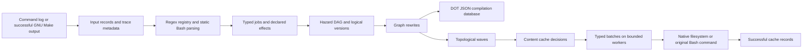

# rusty_make

A conservative Rust proof of concept for executing GNU Make command logs with
native filesystem operations, dependency-safe batches, a copy-chain rewrite, and
a persistent content cache. GNU Make expands Makefiles; this tool does not parse
Makefiles or implement a shell. Linux with Bash is the supported execution host.
Windows-looking paths are tested as Bash arguments, **not** as Windows shell syntax.
No Windows performance or compatibility claim is made.

## Build and run

```sh
cargo build
cargo test
cargo run -- --commands commands.txt -j8 --explain
cargo run -- --commands commands.txt --dry-run --dump-plan plan.json --dump-graph graph.dot
cargo run -- --commands commands.txt --compile-commands compile_commands.json
cargo run -- --commands commands.txt --rebuild-all --no-optimize
```

Commands run relative to the **current working directory**, not the log's parent.
Do not replay untrusted logs: external commands have your process permissions.
The whole input is validated and classified before any job executes. A malformed
line, an ambiguous match, or a rejected registered command aborts the entire plan.
Unknown commands print exactly `unknown: <original line>` on stdout and remain
external jobs. Diagnostics, progress and explain output use stderr. Dry-run prints
human-readable waves to stdout; JSON is written only to the requested file.

| Option | Behavior |
| --- | --- |
| `--commands FILE` | Read a UTF-8 command log; otherwise invoke GNU Make |
| `-j N`, `--jobs N` | Maximum worker threads (default 1); must be positive |
| `--rebuild-all` | Ignore incremental hits; independent of optimization |
| `--no-optimize` | Disable graph rewrites, not native execution or batching |
| `--dump-graph FILE` | Graphviz DOT: original identity, type, strategy, dependency reasons |
| `--dump-plan FILE` | JSON: jobs, parsed metadata, edges, waves, versions, rewrite provenance |
| `--compile-commands FILE` | Compilation database using argv arrays, including in dry-run |
| `--python-script ID=PATH` | Repeatable exact script-specific registration |
| `--explain`, `--verbose` | Classifications, barriers, edges, rewrites, cache reasons, batches, results |
| `--dry-run` | Validate/export/display without executing jobs or writing the cache |
| `--make-arg ARG` | Forward one permitted planner argument (`--make-arg=-f`) |

### Synthetic working build

From the repository root after building:

```sh
cd fixtures/demo
../../target/debug/rusty_make --commands commands.txt -j4 --explain \
  --python-script generate=tools/generate.py \
  --python-script transform=tools/transform.py \
  --compile-commands compile_commands.json
./build/app
# 12
```

Requires `gcc`, `python3`, `sed` and Bash. This exercises all five native utility
families, two Python identities, a text transformation, compilation, linking, an
unknown external command, independent copies and a copy chain. Integration tests
copy this fixture into isolated temporary directories and compare **every regular
file's BLAKE3 hash** against sequential Bash execution and unoptimized execution.

### GNU Make planning

```sh
rusty_make MY_PARAM=x -j8
rusty_make --make-arg=-f --make-arg=Build.mk all -j8
```

Positional Make arguments and repeated `--make-arg` values retain their original
relative ordering, so later variable assignments take precedence as in GNU Make.

The wrapper runs `make -nB --trace -j1`, streams ordered stdout while retaining it,
and returns a parsed log only after Make exits successfully. Rust's `-j8` does not
reach Make. A conservative option allowlist rejects directory changes, overriding
parallelism, execution modes, arbitrary evaluation and Make control-variable
injection. Make environment controls are cleared; diagnostics use `LC_ALL=C`.
Original target identities from GNU Make traces are attached to jobs. Recognized
Make diagnostics are retained separately, never classified as unknown utilities.
Directory-scoped recursive logs are explicitly rejected rather than run in the
wrong directory. Stderr is inherited; ordering between stdout and stderr is not
claimed.

**Make dry-run is not side-effect-free, even with `--dry-run` on rusty_make.**
`$(file ...)`, `$(shell ...)`, Makefile regeneration, `+` recipes and recursive Make
can execute while generating the plan, including before a failed plan. Generated
files from successful planning are available to jobs. Forced recipes might be
replayed twice; Makefiles requiring that workflow are not safely supported. The
wrapper warns before launch. Use trusted Makefiles, preferably in an isolated
build tree. See [the detailed planning contract](docs/coreutils.md#gnu-make-wrapper-contract).

## Architecture



* `input.rs`: physical source line and original command spelling; Make target
  context; active Bash backslash-newline continuations. Open quotes, heredocs and
  compound constructs spanning independent physical records are rejected. One-line
  compound commands may remain external. CRLF records work; CRLF continuations do
  not masquerade as Bash continuations.
* `shell.rs`: **tree-sitter-bash** identifies shell structure and validates the
  whole tree; **shell-words** decodes only proven static words. This was chosen
  over a shell interpreter because the PoC needs syntax boundaries and can defer
  expansion to Bash. Tree-sitter is error-recovering, not an authoritative Bash
  validator, so opaque constructs also receive `bash -n` syntax-only validation.
  No shell expansion runs during parsing. Static commands incur no syntax-check
  subprocess. Parser reference: [tree-sitter-bash Rust API](https://docs.rs/tree-sitter-bash/0.25.1/tree_sitter_bash/).
* `registry.rs`: deterministic registered regex order. **Every matching regex
  counts**, including overlaps within one handler; there are no priorities or
  specificity rules. Exactly one match dispatches the typed parser; rejection is
  fatal. Valid complex syntax remains original-text external work with a barrier.
* `commands.rs`, `job.rs`: clap-derived argument structures and an enum of native
  operations. The enum is the simple type-erased, serializable job representation;
  string identities distinguish configured Python scripts without changing the
  scheduler. Identity and execution strategy are separate. `External`, `Internal`
  and `Batched` strategies are represented; this PoC does not fabricate subprocess
  batching for compilers. Original argv/text and parsed flags are preserved.
* `graph.rs`: original-order RAW, WAW and WAR edges; ancestor/descendant path
  conflicts conservatively order directory operations. `mkdir -p` includes
  implicit parent effects, including prerequisites for sibling outputs.
  Unknown-effect jobs are global barriers. Independent file operations still share waves. Existing
  symlinks are resolved for hazard comparison; existing hardlink aliases force
  barriers. POSIX backslashes are never normalized into separators. Logical
  `path@version` reads and writes aid inspection; files are not snapshotted, so
  WAR edges protect readers from later overwrites. Kahn sorting reports cycles.
* `scheduler.rs`: deterministic waves, then compatible identity/strategy groups.
  Each group is one dispatch and executes native operations sequentially without
  subprocesses; different groups can run concurrently up to `--jobs`. Compiler
  and opaque jobs remain barriers, so no unsafe header/include independence is
  claimed. First failure cancels not-yet-started work; already-running independent
  work finishes, no dependent wave starts, and the process exits nonzero.
* `rewrite.rs`: extensible `GraphRewrite` trait plus a real adjacent copy-chain
  rewrite. `cp A B; cp B C` becomes one two-output operation. **B is preserved**,
  even if it is a final artifact or has other consumers. For ordinary distinct
  new output files it reads A once and writes both outputs with a bounded 64 KiB
  buffer. Existing/aliased/unsupported paths fall back to the original two-copy
  sequence. Source overwrite patterns are rejected; all original jobs remain in
  `provenance`. Future fusion/compile batching/jumbo passes can implement the same
  trait; none are advertised as implemented.

The graph uses pairwise hazard comparisons (quadratic in command count), not a
fully sequential chain. This favors a small, auditable implementation over a
premature indexed dependency engine. No throughput/speedup benchmark is claimed.

## Supported command subsets

| Type | Implemented behavior | Conservative boundary |
| --- | --- | --- |
| `cp SRC DST` | In-process regular-file copy; existing destination permissions retained; new mode respects umask | Exactly two operands; directories, symlink operands, special bits and multiply-linked destinations rejected; no flags |
| `mkdir [-p\|--parents] PATH...` | Native creation; intermediate owner write/search for `-p` | Mode options rejected; overlapping directory effects ordered |
| `touch PATH...` | Native creation or atime/mtime update | Ordinary files only; no options; never skipped |
| `rm [-f\|--force] PATH...` | Native unlink; force ignores missing paths | No recursion/options beyond force; global barrier; never skipped |
| `mv SRC DST` | Native regular-file rename | Same filesystem; no options, directory/symlink/multiply-linked destination behavior; barrier; never skipped |
| `sed` | Typed `-e`, `-f`, `-n`, `-i[SUFFIX]`, operands; original command executed | No native sed/semantic inference; arbitrary scripts are global barriers and never cached |
| GCC/Clang/`cc`/C++ drivers | Typed `-I`, `-D`, `-O` levels, `-g[0-3]`, `-c`, `-o`; source/output metadata | Narrow grammar, not full GCC compatibility; unsupported flags/response files rejected; always external/barrier/dirty |
| Configured Python scripts | Independent identities across `python`, `python3[.N]`, `py`, absolute POSIX interpreter paths | No guessed script dependencies or interpreter options; original-text execution/barrier |
| Other programs | Visible `unknown:` external jobs | Unknown filesystem effects ordered against all other jobs |

Simple stdin/stdout/stderr redirects and stdout append are recognized separately
from argv. Multiple/descriptor redirects and dynamic words, globbing, assignments,
pipelines, substitutions, loops and shell lists stay opaque. Redirection-bearing
recognized utilities are also external barriers after typed parsing, so no native
handler silently drops shell file-opening effects. External execution uses
`bash --noprofile --norc -c` with `BASH_ENV` and `ENV` removed. An opaque recognized
command is not claimed to have parsed command-specific arguments.

Native support is deliberately not a replacement for GNU's complete semantics:
ACLs, extended attributes, ownership preservation, sparse-file heuristics, unusual
filesystem races and timestamp-sensitive workflows are outside the supported
native subset. Native copy/mkdir/touch also reject symlink path components at
execution time: an earlier opaque job must not introduce aliases that invalidate
the planned hazards. Do not run another filesystem-mutating build concurrently
in the same root. A `.rusty_make/build.lock` excludes simultaneous rusty_make
executors; after a crash, verify no build is running before deleting a stale lock.
No transactional rollback is promised for a failed batch.

## Incremental builds

`.rusty_make/cache.json` stores schema/version, stable source position/target,
command/parsed-operation fingerprints, cwd/environment fingerprints, and explicit
input/output BLAKE3 hashes plus permission bits. Files are rehashed every time:
there is no size/mtime shortcut. Directories use an existence/mode marker, not a
recursive hash (creating another child does not invalidate `mkdir -p`). Symlinks,
special files and hardlink aliases do not produce safe cache hits.

Only precisely modeled native copies/copy chains and mkdir jobs are cacheable.
Touch is observable timestamp work and is always executed. Compiler headers,
Python scripts, sed programs and unknown commands may hide arbitrary dependencies:
these jobs and jobs with unknown-effect ancestors are not skipped. GCC `-MMD -MF`
depfiles were considered but are **not implemented**; it would be unsafe to cache
compiler jobs based only on command-line sources.

Cache evaluation happens in dependency order against current file contents. If an
upstream job runs because its arguments changed but writes identical bytes/modes,
a precisely modeled downstream job can still hit its cache. Missing/tampered
outputs and modified inputs force rebuilds. `--rebuild-all` bypasses every hit.
Records are invalidated and saved before launch, then recorded only for successful
completed jobs. Failed/incomplete jobs cannot retain an old success entry. Cache
writes use a synchronized temporary file and rename; interrupted writes may leave
`.rusty_make/cache.json.tmp`, which is explicitly reported instead of overwritten.
The cache is trusted build state, not an adversarial integrity boundary.

## Graph-aware compilation database transforms

The CLI emits standard `compile_commands.json` entries with `directory`, `file`,
`arguments` and optional `output`. Original argv is used rather than a quoted
shell string. One entry is emitted per recognized source; pure linking is omitted.
Compile-and-link invocations with sources are included. Opaque compiler shell
commands are not flattened into misleading entries.

The library exposes the holding object and the graph **before saving**:

```rust,no_run
use rusty_make::compdb::CompilationDatabase;
# fn export(graph: &rusty_make::graph::BuildGraph) -> anyhow::Result<()> {
let mut database = CompilationDatabase::from_graph(graph)?;
database.save_with_transform(graph, std::path::Path::new("compile_commands.json"),
    |graph, database| {
        // Inspect graph.jobs, graph.edges, versions and original provenance.
        for entry in &mut database.commands {
            if graph.jobs.iter().any(|job| job.source.target.as_deref() == Some("generated")) {
                entry.arguments.push("-DGENERATED_BUILD".into());
            }
            entry.directory = "/relocated/build".into();
        }
        Ok(())
    })?;
# Ok(()) }
```

Transforms may filter/add entries or modify fields. A transform error aborts before
touching the destination. The hook is a Rust library API, not evaluation of
arbitrary code from CLI configuration.

## Extending handlers

1. Define clap-derived arguments and a `fn(&ShellCommand) -> anyhow::Result<JobSpec>`.
2. Populate typed parsed metadata, exact file effects and cacheability. Default to
   `unknown_effects: true`, `cacheable: false` if there is any uncertainty.
3. Register one or more anchored regexes with `Registry::register`. Any overlap
   remains fatal; parsers do not resolve ambiguity. `Registry::add_python` is the
   supplied exact-script registration mechanism.
4. Reuse `Operation::External` for metadata-attached fallback behavior, or add a
   native enum variant and its execution branch. The scheduler needs no changes.
5. Test classification, unsupported flags, semantics, hazards and real execution.

[Coreutils investigation](docs/coreutils.md) records reusable uutils crates, their
in-process APIs, process-global concerns, Windows status, GNU compatibility, MIT
license, dependencies and batching practicality. Individual lower-level APIs can
be reused, but CLI entry points are not assumed reentrant. The PoC chose narrow
standard-library operations rather than inherit CLI/global-state machinery.

## Validation and next improvements

Tests cover registry ambiguity (including within one handler and Python overlaps),
quoting/operators/paths, Make traces and continuations, RAW/WAR/WAW/directory
hazards, versions, cycles, barriers, typed batches, failure cancellation, copy-chain
differential execution, cache invalidation/content propagation, compilation
database transforms and real Make planning. Optional compiler/Make integration
tests skip with a message if their external tool is absent. No original Windows
project is required. Run `cargo build` and `cargo test` on the Linux host.

Verified on Linux with Rust 1.94.0, GNU Make 4.3 and GCC 13.3:

* `cargo build`: successful.
* `cargo test`: **71 passed**, no failures, including real compiler, Python, sed,
  Make and differential fixture execution.
* Standalone CLI fixture: 15 commands became 14 nodes with one copy-chain rewrite;
  generated application printed `12`. DOT, plan JSON and a two-entry compilation
  database were written and inspected.
* A standalone two-copy log executed once as a fused node, then executed **zero**
  jobs on the identical second run. `--rebuild-all --no-optimize` executed both
  original jobs. The real Make CLI smoke preserved expansion-generated files and
  copied the planned output correctly.

Commands and diagnostics both retain their original input line numbers in JSON;
rewrite provenance preserves removed command records. Synthetic planner warnings
have no input line number.


Recommended next work, in order:

1. GCC/Clang depfiles and an audited header/tool/environment dependency model.
2. Proven script-specific Python effects and native implementations for hot scripts.
3. An indexed hazard builder and event-driven ready queue; parallel typed batch shards.
4. An explicit shell/backend and path policy for Windows, verified on Windows CI.
5. Pinned, individually audited uutils lower-level APIs where broader GNU semantics
   justify their footprint; benchmark real workloads before new fusion passes.
6. Recursive Make working-directory/protocol support and planning sandboxing.
